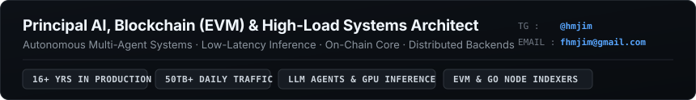

  

<table width="100%">
  <tr>
    <td width="33%" valign="top">
      <b>AI &amp; LLM Infrastructure</b>
      <ul>
        <li>Multi-agent systems (<b>LangGraph</b>, <b>MCP</b>, AST code tooling, isolated container sandboxes).</li>
        <li>Real-time multimodal pipelines: <b>Silero VAD</b>, <b>faster-whisper</b> PCM streaming (&lt;200ms), Vision LLMs.</li>
        <li>Production Hybrid RAG: <b>Qdrant</b> / <b>pgvector</b> + <b>BM25</b> + cross-encoder reranking (<b>BGE</b>, <b>Cohere</b>).</li>
        <li>Self-hosted GPU inference: <b>vLLM</b>, <b>Ollama</b>, AWQ/GGUF quantization, LoRA/QLoRA, Redis semantic caching.</li>
      </ul>
      
<code>Python</code> <code>PyTorch</code> <code>vLLM</code> <code>LangGraph</code> <code>MCP</code> <code>Qdrant</code> <code>pgvector</code> <code>faster-whisper</code> <code>DSPy</code>

    </td>
    <td width="33%" valign="top">
      <b>Blockchain &amp; EVM Core</b>
      <ul>
        <li>Smart contracts in <b>Solidity</b> (<b>Foundry</b>, <b>Hardhat</b>, <b>Slither</b>): ERC-20/721/1155, ERC-4337, 256-bit slot packing, <b>EIP-712</b> auth.</li>
        <li>Custom high-throughput EVM indexers in <b>Go</b> over raw JSON-RPC / WebSockets (<code>eth_subscribe</code>, trace parsing) with automatic chain reorg rollback.</li>
        <li>High-concurrency tx relayers, distributed Redis nonce locks, EIP-1559 fee engines, private RPC / Flashbots routing.</li>
      </ul>
      
<code>Solidity</code> <code>Go</code> <code>Foundry</code> <code>Hardhat</code> <code>Slither</code> <code>EIP-712</code> <code>ERC-4337</code> <code>Geth/Erigon</code> <code>Viem</code>

    </td>
    <td width="33%" valign="top">
      <b>High-Load &amp; Distributed Systems</b>
      <ul>
        <li>Architect &amp; sole tech lead across 20+ production platforms handling <b>50TB+ daily traffic</b>.</li>
        <li>Database internals: <b>PostgreSQL</b> partitioning &amp; planner tuning, <b>ClickHouse</b> (MergeTree) sub-second analytics over 100M+ rows.</li>
        <li>Zero-data-loss financial &amp; event pipelines on <b>Kafka</b> and <b>RabbitMQ</b> with strict idempotency.</li>
        <li>L7 DDoS mitigation, custom WAF, Kubernetes (EKS).</li>
      </ul>
      
<code>Go</code> <code>Python</code> <code>TypeScript</code> <code>PostgreSQL</code> <code>ClickHouse</code> <code>Redis</code> <code>Kafka</code> <code>K8s</code> <code>AWS</code>

    </td>
  </tr>
</table>
